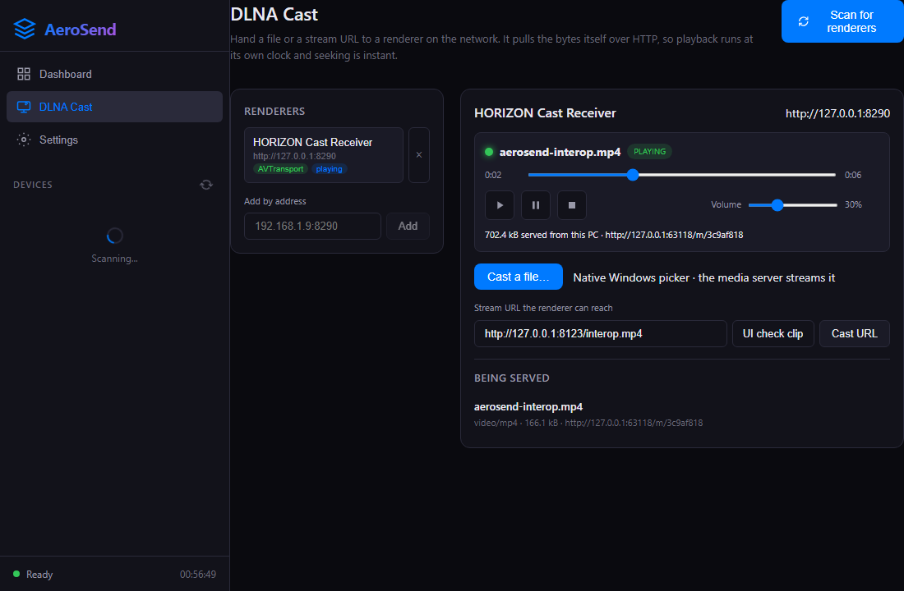
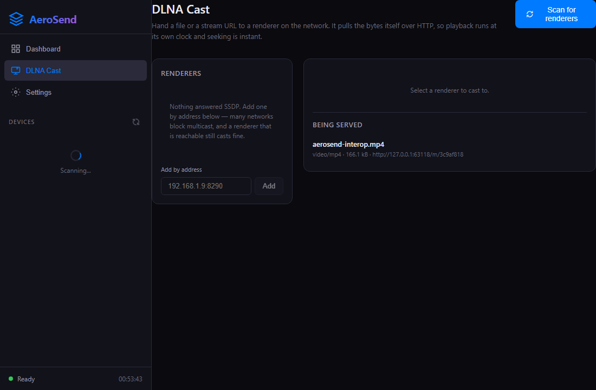

# AeroSend

Windows 上的专业级 AirPlay / DLNA **发送端**。独立项目，与 `D:\codeX\meeting`（HORIZON 会议白板启动器，接收端）不共享代码，只共享协议。

技术栈：Tauri 2 + React 18 + Vite 6 + Rust（采集/编码/协议全在 Rust 侧）。

## 界面

| 投射中 | DLNA 推送 |
| --- | --- |
|  |  |

## 能力

| 模块 | 状态 | 说明 |
| --- | --- | --- |
| 设备发现 | ✅ | mDNS `_airplay._tcp`，扫描不到时可手填 `ip` 或 `ip:port` |
| 屏幕镜像 | ✅ | DXGI Desktop Duplication → x264（zerolatency）/ NVENC / QSV → RTSP + RTP/H.264 |
| 系统音频 | ✅ | WASAPI loopback → AAC 128 kbps，与视频同会话（90 kHz / 44.1 kHz 双时间轴） |
| 视频流推送（DLNA/UPnP AV） | ✅ | SSDP 发现渲染器 → SOAP 控制 + 内置 HTTP 媒体服务器，接收端自己拉流、自己计时 |
| 批注 / 标注 | 🚧 | 规划中（Phase 6） |
| 托盘、设置持久化 | ✅ | 双击托盘恢复窗口；`settings.json` 写入-改名原子落盘 |

## 数据链路

**AirPlay 镜像**

```
DXGI duplication ──┐
                   ├─► encoder (x264 zerolatency / NVENC / QSV) ─► access units ─► FU-A 分片 ─► RTP :90kHz ─┐
WASAPI loopback ───┴─► AAC (ADTS 去框) ─────────────────────────────────────────► RTP :44.1kHz ────────────┤
                                                                                                             ├─► 接收端
RTSP  OPTIONS → ANNOUNCE(SDP) → SETUP(video/audio) → RECORD → … → TEARDOWN  ◄─── RTCP SR（发送端报告）─────┘
```

背压：编码输出队列 `MAX_BACKLOG_FRAMES = 6`，超帧丢弃而不是堆积延迟。

**DLNA 推送**

```
SSDP M-SEARCH ─► 渲染器 ─► GET 设备描述 ─► 解析 3 个 service control URL
                                              │
本地文件 ─► 内置 HTTP 媒体服务器(206/Range/416/HEAD) ◄── SetAVTransportURI(DIDL) ─► AVTransport
URL 直投 ─► 不经本地服务器                                              Play/Pause/Stop/Seek(REL_TIME)
                                                                        RenderingControl Set/GetVolume
                                                                        ConnectionManager GetProtocolInfo
```

关键约束：渲染器是**拉**的一方，所以媒体服务器必须正确实现 Range 分段与 `Content-Range`；播放进度、时长、音量都从设备读回，界面不自己造时钟。

## 目录

```
src/                 React 前端
  pages/Dashboard    设备列表 + 一键开始/停止投射
  pages/StreamView   会话状态、统计
  pages/CastView     DLNA 渲染器与传输控制
  pages/Settings     分辨率/帧率/码率/编码器/音频
src-tauri/src/
  airplay/           discovery(mDNS) rtsp rtp h264
  capture/           screen(DXGI) encoder ffmpeg-sidecar audio(WASAPI) audio_encoder adts
  stream/session.rs  会话编排：协商 → 采集泵 → 发包 → 统计
  upnp/              ssdp device xml avt caster media_server http net
  commands/          25 个 Tauri 命令（前端只通过它们访问协议层）
  annotation/        Phase 6 待接
tests/               集成与互操作用例
docs/TEST-REPORT-phase4-5.md   最近一轮验证记录
```

## 开发

```bash
npm install
npm run tauri dev            # 开发（vite 已忽略 src-tauri/target，避免 EBUSY）
npm run build                # 前端类型检查 + 打包
npm run tauri build          # 发布安装包
```

需要 ffmpeg（`ffmpeg-sidecar` 会自动定位随包或系统 ffmpeg）。编码器可用性不是看 `ffmpeg -encoders` 列没列出来，而是真的喂一帧去打开它——本机就出现过列了 `h264_nvenc` 却在第一帧报 `Cannot load nvcuda.dll` 的情况；`Auto` 会选真正能打开的那个。

## 测试

```bash
cd src-tauri
cargo test                                              # 110 通过 / 2 忽略
cargo test --test test_interop_hub_dmr -- --ignored --nocapture --test-threads=1
```

第二条需要一个真实 DLNA 渲染器在场（例如 HORIZON 启动器的 `dlna-probe`），它会真的解码我们供出的字节。音频相关用例自带 `ffplay` 声源——WASAPI loopback 只镜像正在播放的声音，空闲机器上采不到东西。

完整结果与限制见 [docs/TEST-REPORT-phase4-5.md](docs/TEST-REPORT-phase4-5.md)。

## 已知限制

- 尚未与真实 Apple TV / 第三方电视做过现场验证，当前对端为 HORIZON 接收端与协议级 fake 设备。
- 应用图标仍是占位图。
- 网络要求：镜像走组播发现，公司网络屏蔽 mDNS/SSDP 时使用手填地址入口。
