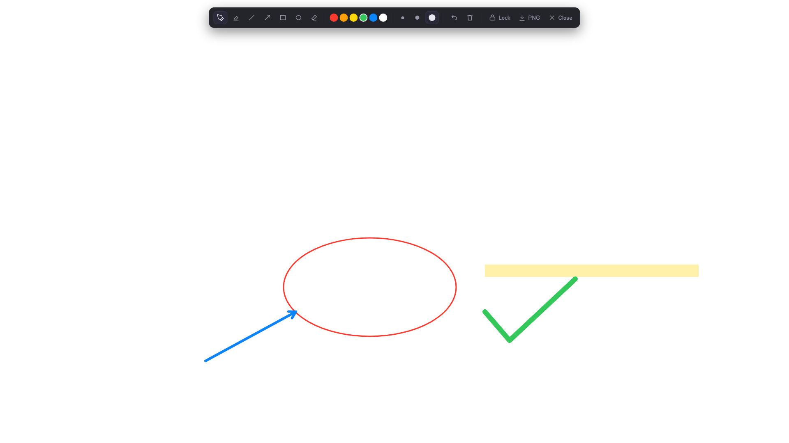
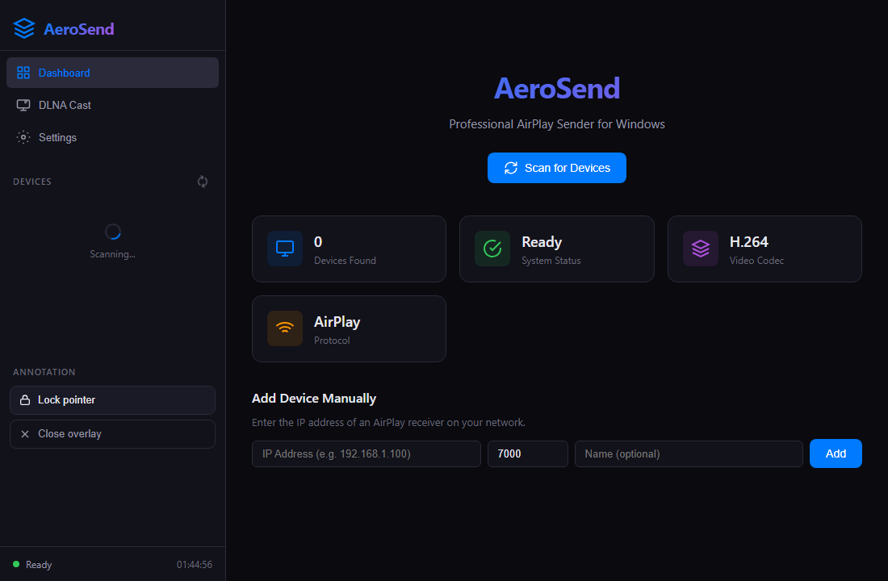

# AeroSend

Windows 上的专业级 AirPlay / DLNA **发送端**。独立项目，与 `D:\codeX\meeting`（HORIZON 会议白板启动器，接收端）不共享代码，只共享协议。

技术栈：Tauri 2 + React 18 + Vite 6 + Rust（采集/编码/协议全在 Rust 侧）。

## 界面

| 投射中 | 媒体投屏 |
| --- | --- |
|  |  |

| 批注层（全屏透明叠加） | 侧栏批注控制 |
| --- | --- |
|  |  |

## 能力

| 模块 | 状态 | 说明 |
| --- | --- | --- |
| 设备发现 | ✅ | mDNS `_airplay._tcp` / `_raop._tcp`，扫描不到时可手填 `ip` 或 `ip:port` |
| 屏幕镜像 | ✅ | AirPlay 2：pair-verify → FairPlay → SETUP(plist) → AES-128-CTR 视频流；DXGI Desktop Duplication → x264（zerolatency）/ NVENC / QSV |
| 镜像音频 | ✅ | 镜像会话内的 stream 96：WASAPI loopback → AAC-LC（1024 采样/包）→ RTP + AES-128-CBC → 接收端 UDP 口；独立 control socket 每 3 s 发 RTP↔NTP 同步包 |
| 系统音频 | ✅ | RAOP 扬声器通道：WASAPI loopback → s16be → L16（PT 96，44.1 kHz 立体声，明文，352 帧/包）；同时带 RTCP SR 和 SETUP 要求的 control/timing 端口 |
| 媒体投屏（DLNA/UPnP AV） | ✅ | 视频、图片、音乐三类都能投：SSDP 发现渲染器 → SOAP 控制（DIDL 按类型给出 `videoItem`/`imageItem.photo`/`audioItem.musicTrack`）+ 内置 HTTP 媒体服务器（地址自带扩展名，只看 URL 的接收端也能认出类型），接收端自己拉流、自己计时 |
| 批注 / 标注 | ✅ | 独立全屏透明置顶窗口（第二个 webview 文档），7 工具 × 6 色 × 3 笔宽 + undo/clear；Lock 走 `WS_EX_TRANSPARENT` 鼠标穿透；墨迹由桌面复制器随屏幕一起送出去，不加第二条编码链路；导出 PNG 走 Windows 原生保存框 |
| 托盘、设置持久化 | ✅ | 双击托盘恢复窗口；`settings.json` 写入-改名原子落盘 |

## 数据链路

**AirPlay 2 镜像（`_airplay._tcp` 且带 `pk`）**

```
DXGI duplication ──► encoder (x264 zerolatency / NVENC / QSV) ──► access units ──► AVCC ──► AES-128-CTR ──► TCP 数据口
WASAPI loopback  ──► ffmpeg AAC-LC ──► ADTS 去头 ──► RTP(1024/包) ──► AES-128-CBC ──► UDP 数据口
                                                                                          │
RTSP  GET /info → pair-setup → pair-verify → fp-setup ×2 → SETUP(stream 110 + stream 96) → RECORD ──┘
```

背压：编码输出队列 `MAX_BACKLOG_FRAMES = 6`，超帧丢弃而不是堆积延迟。镜像音频走 SETUP 里的 stream 96：AAC-LC 每包 1024 采样，AES-128-CBC 每包从 `eiv` 重置、只加密整块（尾块与 12 字节 RTP 头明文），接收端另行指定的 control 口每 3 s 收一次 RTP↔NTP 同步包（UxPlay 系接收端没有同步包就不取音频）。Apple 原厂发送端在该流上用 AAC-ELD，本机 ffmpeg 没有 AAC-ELD 编码器，因此协商为 AAC-LC，见「已知限制」。

**RAOP 音频（`_raop._tcp` 扬声器）**

```
WASAPI loopback ──► ffmpeg 重采样 ──► s16be L16（352 帧/包） ──► RTP :44.1kHz ──┐
                                                                                 ├─► 接收端
RTSP  OPTIONS → ANNOUNCE(SDP: L16/PT96) → SETUP → RECORD → … → TEARDOWN ◄────────┘
                                          │
                                          └─ 带 client_port / control_port / timing_port；RTCP SR 发往接收端 control_port
```

`_raop._tcp` 是 AirPlay 的扬声器服务，只承载音频，所以这条通道不发视频；屏幕镜像走上面的 AirPlay 2 通道。`pk` 是判断依据：带 Ed25519 身份广播的设备才能做 pair-verify。

**媒体投屏（DLNA/UPnP AV）**

```
SSDP M-SEARCH ─► 渲染器 ─► GET 设备描述 ─► 解析 3 个 service control URL
                                              │
本地文件 ─► 内置 HTTP 媒体服务器(206/Range/416/HEAD) ◄── SetAVTransportURI(DIDL) ─► AVTransport
URL 直投 ─► 不经本地服务器                                              Play/Pause/Stop/Seek(REL_TIME)
                                                                        RenderingControl Set/GetVolume
                                                                        ConnectionManager GetProtocolInfo
```

关键约束：渲染器是**拉**的一方，所以媒体服务器必须正确实现 Range 分段与 `Content-Range`；播放进度、时长、音量都从设备读回，界面不自己造时钟。供出的地址是 `/m/{id}.{ext}`——扩展名从注册文件带来，只作为提示：不少渲染器（含 HORIZON 中枢）只看地址认类型，MIME 与字节数的权威仍是注册的那份文件。

## 目录

```
design/              图标源文件（app-icon.svg：1024 方图、透明圆角底）
src/                 React 前端（两个文档：index.html 主控 / annotate.html 批注层，样式表互不包含）
  pages/Dashboard    设备列表 + 一键开始/停止投射
  pages/StreamView   会话状态、统计
  pages/CastView     媒体投屏：渲染器列表、传输控制与投出类型（视频/图片/音乐）
  pages/Settings     分辨率/帧率/码率/编码器/音频
  pages/AnnotationOverlay  全屏透明批注层
src-tauri/src/
  airplay/           discovery(mDNS) handshake(pair-verify/FairPlay) mirror(加密流) h264 rtp aes
  capture/           screen(DXGI，按主屏桌面矩形选 adapter+output) encoder ffmpeg-sidecar audio(WASAPI) audio_encoder adts
  stream/mirror.rs   AirPlay 2 镜像：握手 → 采集/编码 → AES 加密写入数据口
  stream/mirror_audio.rs 镜像音频：AAC-LC → RTP + AES-128-CBC → stream 96 数据口，control 口发同步包
  stream/session.rs  RAOP 音频：协商 → 采集/重采样 → L16 RTP
  stream/pipeline.rs 镜像与采集共用的编码管线（背压、access unit 分组）
  upnp/              ssdp device xml avt caster media_server http net
  commands/          30 个 Tauri 命令（前端只通过它们访问协议层）
  annotation/        批注窗口生命周期（开 / 关 / 鼠标穿透），墨迹本身在 canvas 里
tests/               集成与互操作用例
docs/TEST-REPORT-phase4-5.md   音频 + DLNA 那一轮的验证记录
docs/TEST-REPORT-phase6.md     批注层与采集链路加固那一轮的验证记录
docs/TEST-REPORT-phase7.md     AirPlay 2 镜像与 RAOP L16 互操作记录
docs/TEST-REPORT-phase8.md     镜像音频（stream 96）验证记录
docs/TEST-REPORT-phase9.md     前端中文本地化验证记录
docs/TEST-REPORT-performance.md 镜像全链路分阶段耗时与流畅度优化记录
docs/TEST-REPORT-mirror-stall.md 10053 断流、弹窗与中途 refused data 三处根因与修复
docs/TEST-REPORT-media-cast.md  媒体投屏改名与图片/音乐投屏的根因、修复与实测
```

## 开发

```bash
npm install
npm run tauri dev            # 开发（vite 已忽略 src-tauri/target，避免 EBUSY）
npm run build                # 前端类型检查 + 打包
npm run tauri build          # 发布安装包
npx tauri icon design/app-icon.svg -o src-tauri/icons    # 改了图标源就重新生成全套（托盘用同一张内嵌图）
```

需要 ffmpeg（`ffmpeg-sidecar` 会自动定位随包或系统 ffmpeg）。编码器可用性不是看 `ffmpeg -encoders` 列没列出来，而是真的喂一帧去打开它——本机就出现过列了 `h264_nvenc` 却在第一帧报 `Cannot load nvcuda.dll` 的情况；`Auto` 会选真正能打开的那个。

## 测试

```bash
cd src-tauri
cargo test                                              # 178 单测 + 集测通过 / 5 忽略
AEROSEND_PEER=127.0.0.1:5000 \
  cargo test --test test_interop_airplay -- --ignored --nocapture --test-threads=1
cargo test --test test_interop_hub_dmr -- --ignored --nocapture --test-threads=1
```

AirPlay 互操作需要 HORIZON 接收端在镜像页在线（RAOP 音频 + AirPlay 2 镜像 + mDNS 能力广播三条）；DLNA 那条需要一个真实渲染器在场（例如 HORIZON 启动器的 `dlna-probe`），它会真的解码我们供出的字节。音频相关用例自带 `ffplay` 声源——WASAPI loopback 只镜像正在播放的声音，空闲机器上采不到东西。

完整结果与限制见 [docs/TEST-REPORT-phase4-5.md](docs/TEST-REPORT-phase4-5.md)、[docs/TEST-REPORT-phase6.md](docs/TEST-REPORT-phase6.md)、[docs/TEST-REPORT-phase7.md](docs/TEST-REPORT-phase7.md)、[docs/TEST-REPORT-phase8.md](docs/TEST-REPORT-phase8.md)、[docs/TEST-REPORT-phase9.md](docs/TEST-REPORT-phase9.md)，以及 [性能](docs/TEST-REPORT-performance.md)、[断流修复](docs/TEST-REPORT-mirror-stall.md) 与 [媒体投屏](docs/TEST-REPORT-media-cast.md) 三轮。

投照片这一条还依赖接收端：HORIZON 中枢要把 `img-src` 放开到 `http:`，否则图片字节完整到达却渲染不出来（页面源是 `http://tauri.localhost`，局域网地址不属于 `'self'`）。

## 已知限制

- 尚未与真实 Apple TV / 第三方电视做过现场验证，当前对端为 HORIZON 接收端与协议级 fake 设备。
- **镜像音频的编码格式不是 Apple 原厂的 AAC-ELD**：ffmpeg 官方 Windows 构建没有 AAC-ELD 编码器（需要 libfdk_aac），镜像会话因此按 `ct=4`（AAC-LC，1024 采样/包）协商 stream 96。按协商值分派的接收端（UxPlay 系）可以解，Apple 硬件发送端固定用 `ct=8`（AAC-ELD，480 采样/包），未在 Apple TV 上验证。本轮 HORIZON hub 收下这条流后丢弃，所以「接收端接受」只证明协商与封包格式，不证明能出声。
- **镜像音频的 UDP 丢包不重传**：发送端不接 retransmit 请求，局域网丢包会直接造成音频空洞；A/V 同步只依赖每 3 s 的同步包，未做音视频时间轴校准。
- **RAOP 只承载音频**：`_raop._tcp` 是 AirPlay 的扬声器服务，接收端只解 L16。屏幕画面走 AirPlay 2 镜像通道；不带 `pk` 的设备（或手填地址）只能投音频。
- **批注的"墨迹是否出现在接收端画面上"还没能在本机证明**：控制台锁屏时，屏幕复制（DXGI）与 GDI 屏幕 DC 都读不到任何窗口内容——实测同一时刻一个真实全屏纯红窗口 `PrintWindow` 100% 红、`CopyFromScreen` 0% 红、`DuplicateOutput` 全帧 0% 非零。批注层自身的像素正确性是按窗口表面逐项量过的（见 Phase 6 报告），端到端那一段需在解锁的控制台或真机上复跑 `cargo test --test test_capture -- --nocapture`。
- 网络要求：镜像走组播发现，公司网络屏蔽 mDNS/SSDP 时使用手填地址入口。
- 界面文案为中文；协议与采集的深层错误链（RTSP 状态码、DXGI/ffmpeg 报错等）保留英文原文，便于和日志、上游文档对照。
